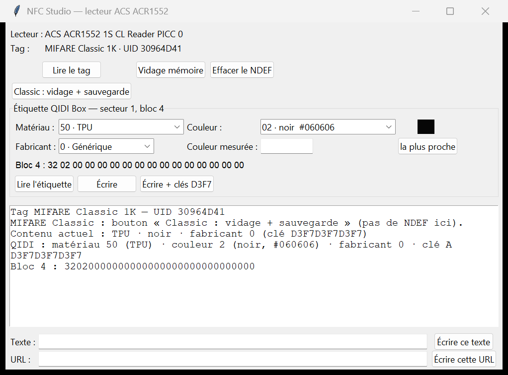

# NFC Studio

Lecture et écriture de tags NFC et de cartes MIFARE Classic via PC/SC, avec un module dédié aux
**étiquettes de bobines de filament pour la QIDI Box**.

Écrit en Python (pyscard + ndeflib), une seule dépendance native : un lecteur PC/SC du commerce
(testé sur **ACS ACR1552 1S**). Fonctionne sous Linux et sous Windows.



**Sommaire** — [Ce que fait l'outil](#ce-que-fait-loutil) · [Installation](#installation) ·
[Utilisation](#utilisation) · [Prise en main](#prise-en-main-en-cinq-minutes) ·
[Mode d'emploi de l'interface](#le-mode-demploi-de-linterface) ·
[Format QIDI](#étiquettes-qidi-box--le-format) · [Sauvegardes](#sauvegardes-de-cartes-mifare-classic) ·
[Pièges](#pièges-connus) · [Dépannage](#dépannage) · [Licence](#licence-et-transparence)

## Ce que fait l'outil

**Tags Type 2 / NDEF (NTAG213, NTAG215, NTAG216, MIFARE Ultralight)**
- lecture du message NDEF, décodage des enregistrements texte et URL ;
- écriture d'un texte ou d'une URL, effacement du message ;
- formatage d'un tag vierge (CC à zéro) avant la première écriture ;
- vidage mémoire page par page.

**MIFARE Classic 1K / 4K**
- vidage complet secteur par secteur : authentification clé A puis clé B avec une liste de clés
  d'usine et de clés normalisées NFC Forum ;
- repérage de ce qui est resté en configuration d'usine (clés par défaut, bits d'accès `FF078069`) ;
- décodage de l'annuaire MAD et extraction du NDEF s'il existe ;
- **sauvegarde en quatre fichiers** par tag : `dump.json` (structure complète), `dump.mfd` (image
  binaire de 1024 ou 4096 octets, format des outils mfoc/mfcuk), `rapport.txt` lisible, `cles.txt`.

**Étiquettes QIDI Box (filament)**
- lecture et écriture du bloc 4 (secteur 1) : code matériau, code couleur, code fabricant ;
- 35 matériaux et 24 couleurs QIDI en listes déroulantes, avec pastille de couleur ;
- champ « couleur mesurée » qui accepte un `#RRGGBB` et choisit la teinte QIDI la plus proche ;
- réécriture optionnelle du trailer du secteur 1, au choix en `D3F7D3F7D3F7` (clé NDEF du NFC Forum,
  comme les étiquettes d'origine) ou en `FFFFFFFFFFFF` (clés d'usine, lues par la plupart des applis).

## Installation

### Linux

```bash
sudo apt install pcscd pcsc-tools python3-tk        # ou zypper install pcsc-ccid pcsc-tools python3-tk
python3 -m venv ~/nfc-studio/venv
~/nfc-studio/venv/bin/pip install pyscard ndeflib
~/nfc-studio/venv/bin/python nfc_studio.py
```

Sous openSUSE, `python3-pyscard` existe aussi en paquet ; le venv évite les surprises de version.

### Windows

Aucun pilote à installer : le lecteur est CCID, Windows le prend en charge nativement
(`SCardSvr` doit être démarré).

```powershell
winget install -e --id Python.Python.3.13
py -m venv C:\Users\<vous>\nfc-studio\venv
C:\Users\<vous>\nfc-studio\venv\Scripts\python.exe -m pip install pyscard ndeflib
```

`pyscard` s'installe par wheel, sans compilateur ; `tkinter` est fourni par l'installeur python.org.

Pour lancer d'un double-clic, créer deux fichiers dans le dossier de l'outil :

```bat
:: nfc-studio-gui.cmd  (sans fenêtre noire)
@echo off
"%~dp0venv\Scripts\pythonw.exe" "%~dp0nfc_studio.py"

:: nfc-studio-cli.cmd  (avec console, pour les commandes)
@echo off
"%~dp0venv\Scripts\python.exe" "%~dp0nfc_studio.py" %*
```

Puis clic droit sur `nfc-studio-gui.cmd` → Envoyer vers → Bureau (créer un raccourci).

## Utilisation

### Interface graphique

Lancement direct (`python nfc_studio.py`, ou `pythonw` sous Windows pour éviter la console).
La fenêtre lit automatiquement le tag posé, remplit les listes QIDI avec son contenu actuel et
affiche en direct les seize octets qui seront écrits.

### Ligne de commande

```bash
python nfc_studio.py --cli readers                      # liste les lecteurs PC/SC
python nfc_studio.py --cli info                         # tag NDEF : contenu lisible
python nfc_studio.py --cli dump                         # tag Type 2 : dump page par page
python nfc_studio.py --cli write-text "bonjour"          # écrit un texte NDEF
python nfc_studio.py --cli write-url https://exemple.fr  # écrit une URL
python nfc_studio.py --cli erase                        # efface le NDEF

python nfc_studio.py --cli classic                      # MIFARE Classic : vidage + sauvegarde
python nfc_studio.py --cli classic --keys AABBCCDDEEFF  # avec une clé en plus
python nfc_studio.py --cli classic --out /tmp/dumps     # change le dossier de sauvegarde

python nfc_studio.py --cli qidi-tables                  # tables matériaux / couleurs
python nfc_studio.py --cli qidi-read                     # décode l'étiquette posée
python nfc_studio.py --cli qidi-write --material PETG-CF --color #FF362D
python nfc_studio.py --cli qidi-write --material 42 --color 18 --fix-keys d3f7
python nfc_studio.py --cli qidi-write --material 42 --color 18 --fix-keys ffff  # clés d'usine
```

`--material` accepte le numéro ou le nom, `--color` le numéro, le nom français ou un `#RRGGBB`.

## Prise en main en cinq minutes

1. **Brancher le lecteur.** Aucun pilote sous Windows (CCID natif, service `SCardSvr` actif) ;
   sous Linux, `pcscd` doit tourner (`sudo systemctl status pcscd`).
2. **Lancer l'outil.** `python nfc_studio.py` ou, sous Windows, le raccourci du Bureau.
   La première ligne de la fenêtre affiche le lecteur détecté, la seconde « aucun tag ».
3. **Poser un tag** sur le lecteur. La ligne du tag passe au modèle et à l'UID ; pour une MIFARE
   Classic, le journal annonce le type et propose le vidage.
4. **Lire** ce qu'il contient : bouton « Lire l'étiquette » pour le module QIDI, ou
   `--cli classic` pour un vidage complet avec sauvegarde.
5. **Écrire** : choisir matériau, couleur et fabricant dans les trois listes, vérifier la ligne
   `Bloc 4 : …` qui montre les seize octets, puis « Écrire + clés FFFF ».
6. **Vérifier** : le journal affiche la demande, puis les octets relus sur la puce. Poser
   l'étiquette sur la bobine et la présenter à la box.

Si le lecteur n'apparaît pas, voir la section Dépannage : c'est presque toujours une autre
application qui tient le lecteur, ou une session Windows non interactive.

## Le mode d'emploi de l'interface

| Zone | Ce qu'elle fait |
|---|---|
| ligne « Lecteur » / « Tag » | lecteur PC/SC retenu (slot `PICC`, jamais `SAM`) et tag présent |
| champ Texte / URL | écriture d'un message NDEF texte ou URL sur un tag Type 2 |
| bouton « Classic : vidage + sauvegarde » | lit les 16 secteurs et écrit les quatre fichiers de sauvegarde |
| listes Matériau / Couleur / Fabricant | choix QIDI, en lecture seule pour éviter les valeurs libres |
| pastille colorée | rappel visuel de la couleur choisie |
| champ « Couleur mesurée » | coller un `#RRGGBB` puis « la plus proche » pour retrouver la teinte QIDI |
| ligne « Bloc 4 : … » | aperçu en direct des seize octets qui seront écrits |
| case « signer QIDI » | ajoute `QIDI` dans les octets 12-15, comme l'application Android |
| boutons Lire / Écrire / Écrire + clés FFFF | lecture, écriture simple, écriture avec remise des clés du secteur 1 en clé d'usine |
| journal | tout ce qui est fait, avec la demande et la relecture de contrôle |

Deux réflexes de sécurité : l'outil **relit toujours après écriture** et signale une incohérence
entre la demande et le contenu réel ; et il annule l'écriture si la sélection a changé pendant la
connexion au tag.

## Étiquettes QIDI Box : le format

La QIDI Box lit des puces **FM11RF08S**, clones MIFARE Classic 1K. Trois octets suffisent, dans le
bloc 4 (secteur 1, bloc 0) :

| Octet | Sens | Plage |
|---|---|---|
| 0 | code matériau | 1..50 |
| 1 | code couleur | 1..24 |
| 2 | code fabricant | 1 par défaut |

Les octets 3 à 11 sont à zéro ; les octets 12 à 15 portent la signature ASCII `QIDI` (`51 49 44 49`)
sur les étiquettes de l'application Android du même nom, que l'outil reproduit par défaut. Un bloc 4
entièrement nul signifie « étiquette vierge ».
Clés rencontrées sur ces étiquettes : `D3F7D3F7D3F7` puis `FFFFFFFFFFFF`. En pratique **la box
n'accepte que la clé d'usine `FFFFFFFFFFFF`** : une étiquette dont le secteur 1 reste en `D3F7` est
refusée. Le bouton « Écrire + clés FFFF » règle le cas.

Tables complètes et pièges : [`docs/qidi-box-rfid.md`](docs/qidi-box-rfid.md).

## Sauvegardes de cartes MIFARE Classic

Chaque vidage crée un dossier `dumps/<horodatage>_<UID>/` contenant :

- `dump.json` : UID, SAK, ATQA, zone constructeur, secteur par secteur la clé utilisée, les blocs en
  hexadécimal, le trailer, les drapeaux « resté en configuration d'usine » ;
- `dump.mfd` : image binaire brute, directement réutilisable avec mfoc, mfcuk ou la plupart des
  outils de clonage ;
- `rapport.txt` : le même contenu en clair, lisible sans outil ;
- `cles.txt` : uniquement les clés qui ont ouvert au moins un secteur.

Exemple de rapport : [`docs/exemple-vidage-classic.txt`](docs/exemple-vidage-classic.txt).

## Pièges connus

- **PC/SC est inaccessible depuis une session non interactive sous Windows** (SSH, service) : les
  commandes échouent en `0x80100066` « la carte ne répond pas à la réinitialisation ». Exécuter
  l'outil dans la session de l'utilisateur (raccourci, ou tâche planifiée en
  `-LogonType Interactive -RunLevel Highest`).
- **Une seule application peut tenir le lecteur** : NFC Tools, un script en boucle ou un autre outil
  ouvert provoquent les mêmes erreurs trompeuses. Fermer avant de tester.
- Sur les lecteurs à deux slots (ACR1552 **1S**), il faut choisir le slot `PICC` et ignorer `SAM` ;
  l'outil le fait automatiquement.
- Sur une MIFARE Classic, `FF B0` renvoie `6982` tant qu'aucune authentification n'a eu lieu : ce
  n'est pas une carte verrouillée, il manque la séquence `FF 82` (clé) puis `FF 86` (authentification).
- Windows à mise à l'échelle 150 % : sans conscience du DPI, une fenêtre de 1000 px logiques déborde.
  L'outil déclare son awareness DPI et se recalibre si la résolution change.

## Dépannage

| Symptôme | Cause probable | Solution |
|---|---|---|
| `Aucun lecteur PC/SC` | lecteur absent, ou `pcscd` arrêté | rebrancher ; `sudo systemctl restart pcscd` ; `--cli readers` |
| `Aucun tag sur le lecteur` | tag mal posé ou hors portée | le poser à plat, centré sur l'antenne |
| `0x80100066` carte ne répond pas | session non interactive, ou autre logiciel qui tient le lecteur | lancer dans la session utilisateur ; fermer NFC Tools et les autres scripts |
| `6982` à la lecture d'une Classic | authentification manquante | l'outil la fait seul ; vérifier que le tag est bien une Classic (SAK 08/18) |
| `Aucune clé connue n'ouvre le secteur 1` | étiquette d'une autre marque, ou clé propriétaire | c'est le cas des tags verrouillés : impossible sans la clé |
| La box ne reconnaît pas l'étiquette | secteur 1 resté en `D3F7`, ou pas de bloc 4 | « Écrire + clés FFFF » puis reposer l'étiquette |
| Mauvais matériau écrit | sélection perdue (ancienne version) | mettre à jour : chaque sélection et chaque demande sont journalisées |
| Fenêtre trop grande sous Windows | mise à l'échelle 150 % | version à jour, l'outil est DPI-aware |

## Licence et transparence

Distribué sous **GNU General Public License v3.0** (voir [`LICENSE`](LICENSE)).
Aucune garantie : une écriture malheureuse sur une carte peut la rendre illisible.

**Ce code a été écrit par un agent IA.** Les spécifications, les essais sur matériel réel, les choix
techniques et les décisions de publication sont ceux de Jean-Paul Rouzé ; le code a été produit,
corrigé et vérifié par l'agent Hermes « Mercure » (modèle deepseek) au cours d'échanges documentés.
Le procédé est signalé ici pour que personne ne se trompe sur l'origine du logiciel.

Contributions bienvenues : ouvrez une *issue* avec le modèle de lecteur et de tag utilisé, et les
codes d'erreur exacts.
